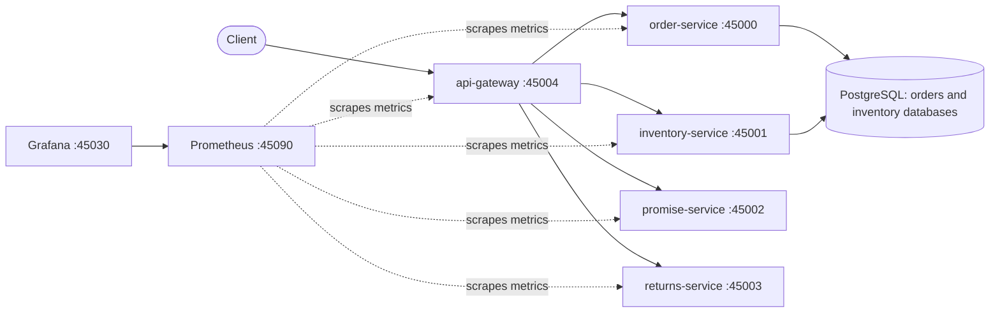

# AmazonFulfilmentOps


An order-to-delivery platform built to practise software and DevOps engineering end to end: five FastAPI services behind a gateway, PostgreSQL persistence, CI/CD, containers, monitoring, and failure drills with measured before/after results.

The domain is e-commerce fulfilment: place an order, reserve stock without overselling, get a delivery promise, handle returns and refunds. Everything runs locally with Docker Compose. It is a portfolio project: synthetic data, no authentication, and no cloud deployment yet (see Limits).

## Architecture



Only the gateway is published on the host. PostgreSQL and the internal services are reachable only on the Compose network; Prometheus and Grafana are bound to 127.0.0.1.

A checkout (`POST /checkout`) runs these steps:

1. Rejected immediately if inventory's circuit breaker is open, before any order exists.
2. Create the order in order-service (the `Idempotency-Key` header is honoured).
3. Reserve stock in inventory-service, all or nothing; if that fails the order is cancelled.
4. Ask promise-service for a delivery window. This call is optional: if it fails or is slow, checkout still succeeds and the response is flagged `degraded`.

| Service | Port | What it does |
|---|---|---|
| api-gateway | 45004 | Checkout orchestration, rollback, deadlines, circuit breakers, load shedding |
| order-service | 45000 | Orders with idempotent creation and cancellation (PostgreSQL) |
| inventory-service | 45001 | Stock and atomic reservations with row locking (PostgreSQL) |
| promise-service | 45002 | Delivery window from region, service level, stock, cut-off time and holidays |
| returns-service | 45003 | Return state machine, 30-day window, restocking fee, integer money in paise |

## Quick start

Requires Docker with Compose v2.

```bash
git clone https://github.com/Aay6827/AmazonFulfilmentOps.git
cd AmazonFulfilmentOps
docker compose up -d --wait
```

Seed stock, then open the gateway's interactive docs at http://localhost:45004/docs.

```bash
# Linux, macOS, WSL
docker compose exec -T inventory-service python - < scripts/seed_regions.py
```

```powershell
# Windows PowerShell
Get-Content scripts\seed_regions.py -Raw | docker compose exec -T inventory-service python -
```

Example body for `POST /checkout`:

```json
{"customer_id": "C1", "region": "south", "service_level": "standard", "items": [{"sku": "SKU-1", "qty": 1}]}
```

With monitoring:

```bash
docker compose -f docker-compose.yml -f docker-compose.monitoring.yml up -d --wait
```

Grafana: http://localhost:45030/d/fulfilment-ops (anonymous viewing, or admin/admin). Prometheus: http://localhost:45090. The compose file uses a development-only database password by default; set `POSTGRES_PASSWORD` to override it.

## Tests

```bash
pip install -r requirements-dev.txt
ruff check .
cd services/order-service && pytest -q        # repeat for each service
```

There are 85 unit tests across the five services. 18 more PostgreSQL integration tests (order and inventory stores, including concurrent-request and restart tests) run when `TEST_DATABASE_URL` is set; CI runs them against a real PostgreSQL service and fails if they are skipped.

`python scripts/smoke_ci.py` runs against the Compose stack: health, port exposure, non-root containers, checkout flows, idempotent retry, out-of-stock rollback, a return, and graceful behaviour with promise-service and inventory-service stopped.

## CI/CD

GitHub Actions runs 9 jobs on every push: lint (ruff), a unit-test matrix (one job per service), two PostgreSQL integration jobs, and a container job that builds the images, starts the stack and runs the smoke test. Dependabot proposes updates for actions, pip dependencies and Docker base images.

## Engineering decisions

- Idempotency: order creation honours an idempotency key, and reservations are keyed by order id, so retries and concurrent duplicates do not double-create or double-reserve.
- No overselling: reservations are all-or-nothing, stock rows are locked in sorted order, and database constraints back up the application checks. A test runs 40 concurrent reservations against 10 units.
- Compensation: if reserving stock fails, the gateway cancels the order it just created.
- Graceful degradation: the delivery promise is optional, so a promise-service outage degrades a checkout instead of failing it.
- Bounded latency: every downstream call runs under a hard deadline enforced outside the HTTP client (1.5 s critical, 0.5 s optional, 3 s per checkout), behind a per-dependency circuit breaker with load shedding.
- Container hardening: non-root user, read-only root filesystem, all Linux capabilities dropped, no-new-privileges, and only the gateway published.
- Observability: Prometheus metrics in every service, 8 alert rules, and an 11-panel Grafana dashboard provisioned from files.

## Reliability drills and results

Failures were injected under load and the results recorded in [docs/incident-report.md](docs/incident-report.md), with raw data in `docs/`. The drills found real defects, which were then fixed and re-measured.

| Finding | Before | After |
|---|---|---|
| Inventory restart with in-memory state: live orders without a stock reservation | 585 of 800 | 0 of 853 (PostgreSQL) |
| Checkout peak p95 latency while promise-service was down | 9.25 s and 4.88 s (two runs) | 0.06 s |
| Checkout peak p95 latency while inventory-service was down | 3.62 s | 0.06 s |
| Baseline p95 for comparison | 0.05 s to 0.08 s | 0.06 s |
| Load requests completed during the promise-service outage | 15 | 213 |
| `CheckoutLatencyP95High` alert during the outages | fired | never fired |

What the drills showed:

- In-memory state loss: restarting inventory-service silently dropped reservations. Moving to PostgreSQL fixed it, and a probe (`scripts/orphan_probe.py`) now checks orders against reservations across an order-service restart.
- A stopped container's hostname is removed by Docker, and the name lookup stalled for 4 s to 8 s (measured: a raw DNS failure after 7.86 s and an HTTP client failure after 4.0 s, against a 2.0 s timeout). The HTTP client's timeout does not cover name resolution, which is why per-call deadlines now run outside the client.
- Detection: services stopped for 45 s to 80 s raised an alert within about 22 s to 38 s. A `db_up` gauge lets `DatabaseUnreachable` name the failing database, and `ServiceRestarted` makes a 2 s restart visible, which `ServiceDown` missed.

## Limits

- Everything runs on one machine with Docker Compose. There is no cloud deployment; Terraform and an AWS version are not written yet.
- Order-service and inventory-service share one PostgreSQL instance (separate databases). That is a single point of failure, and during a database outage the gateway cannot cancel an order it has just created.
- Each result above comes from a single run, so timings carry no variance estimate (two runs of the same drill differed by about 2x in latency peaks and about 4 s in alert timing). The load generator is closed-loop; an open-loop test (for example with k6) has not been done.
- Synthetic data, simplified business rules, no authentication or authorisation.

## Repository layout
